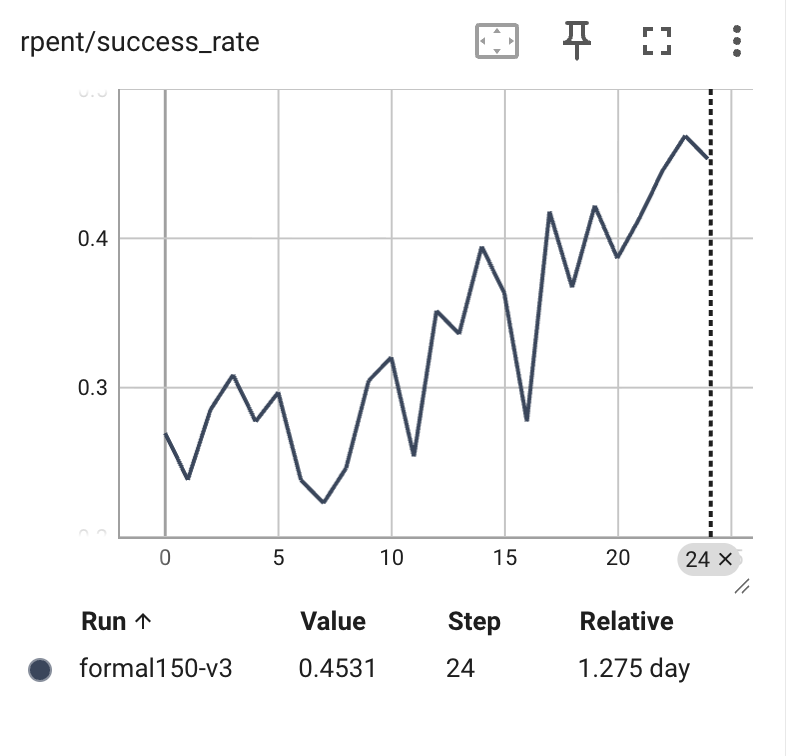

RPent Planner Training
======================

RPent executes the planner's tool calls in LIBERO. RLinf samples the planner's responses and trains it on the resulting episodes. Choose a recipe by the observations the planner receives.

* **Images and end-effector control.** Follow the :doc:`setup guide <../rpent_libero_rl_setup>` for standard LIBERO and SAM3. The :doc:`multimodal PPO and SAO recipe <../rpent_libero_rl>` includes a single-node A100 example that runs one episode, trains for two updates and resumes from a checkpoint.
* **Text and Pi0.5.** The :doc:`synchronous PPO recipe <../rpent>` uses Pi0.5 and SAM3 on LIBERO-Pro. The planner receives text from the tools.

Synchronous GRPO on LIBERO-Pro
------------------------------

This run started from the SFT595-e3 checkpoint of Qwen3.5-4B. Four nodes with 32 H100 GPUs in total ran SGLang and Megatron. A separate node served the environments on eight A100 GPUs with 40 environment slots per GPU.

Each group sampled eight trajectories from the same task and initial state. Each round started 40 groups and trained the actor on the first 32 complete groups (256 trajectories), including groups with identical rewards. The remaining candidates were cancelled before the weight update. Each point shows the fraction of selected trajectories that succeeded. The first update replayed 256 trajectories collected with the starting policy. Subsequent updates used fresh rollouts.

   At TensorBoard step 24 (the 25th update), 116 of the 256 selected trajectories succeeded (45.31%). This is a training metric. Independent evaluation uses a fixed set of tasks and initial states.

Across updates 1–10, 688 of 2,560 selected trajectories succeeded (26.88%). Across updates 16–25, 1,028 of 2,560 succeeded (40.16%). Both windows use the raw TensorBoard scalar from the same run.

:download:`Experiment settings and source revisions (YAML) <../../../../../../examples/agent/rpent/experiments/libero_pro_grpo/settings.yaml>`. This run used an experimental critic-free GRPO entry point, whole-group selection and a remote environment service. This branch provides launch configurations for PPO and SAO. Reproducing the plotted run also requires the experimental source patches, SFT weights and task manifest.

.. toctree::
   :hidden:

   Multimodal PPO and SAO <../rpent_libero_rl>
   Pi0.5 and synchronous PPO <../rpent>
