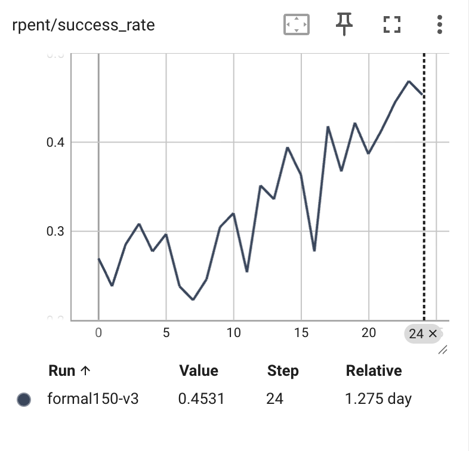

RPent 规划器训练
================

RPent 在 LIBERO 中执行规划器生成的工具调用，RLinf 负责采样与训练。运行本分支的示例时，按规划器接收的观测选择配置。

* **图像与末端控制**\ ：按 :doc:`环境安装 <../rpent_libero_rl_setup>` 准备标准 LIBERO 和 SAM3，再用 :doc:`多模态 PPO 与 SAO <../rpent_libero_rl>` 的单机 A100 配置采集一个 episode，更新两次模型参数，再从 checkpoint 恢复训练。
* **文本与 Pi0.5**\ ：按 :doc:`同步 PPO <../rpent>` 部署 Pi0.5 和 SAM3，让规划器根据工具返回的文本完成 LIBERO-Pro 任务。

同步 GRPO 在 LIBERO-Pro 上的训练结果
-----------------------------------------------

这次实验从 Qwen3.5-4B 的 SFT595-e3 权重开始。4 台机器共 32 张 H100，负责 SGLang 采样和 Megatron 训练。另一台机器用 8 张 A100 运行环境服务，每张卡配置 40 个环境槽位。

每组从同一任务和初始状态采样 8 条轨迹。每轮发起 40 组，取最先完成的 32 个完整组更新 Actor，共 256 条轨迹。组内奖励相同的组也会入选，其余候选在切换权重前取消。图中每个点表示该次更新所选轨迹中任务成功的比例。第 1 次更新复用了初始策略预先采集的 256 条轨迹，后续批次在线采样。

   TensorBoard 的 step 从 0 开始。step 24 对应第 25 次更新，所选的 256 条轨迹中有 116 条成功（45.31%）。该指标来自训练采样，独立评测需另用固定的任务与初始状态。

按图中同一次训练的原始记录汇总，第 1–10 次更新有 688/2,560 条轨迹成功（26.88%），第 16–25 次更新有 1,028/2,560 条成功（40.16%）。

:download:`查看实验参数与源码版本（YAML） <../../../../../../examples/agent/rpent/experiments/libero_pro_grpo/settings.yaml>`\ 。这次实验使用无 Critic 的 GRPO 训练入口，按完整轨迹组筛选训练数据，并通过远程环境服务运行 LIBERO-Pro。本分支提供 PPO 和 SAO 启动配置；复现图中结果还需要实验版源码补丁、相同的 SFT 权重和任务清单。

.. toctree::
   :hidden:

   多模态 PPO 与 SAO <../rpent_libero_rl>
   Pi0.5 与同步 PPO <../rpent>
